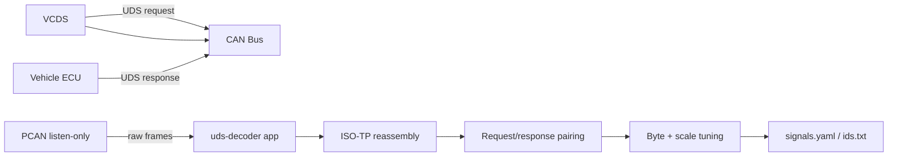

# uds-decoder

Python tool for reverse-engineering UDS diagnostic signals on VAG vehicles using **VCDS** and a passive **PCAN** sniffer. Inspired by [TUMFTM/uds-decoder](https://github.com/TUMFTM/uds-decoder).

VCDS sends UDS requests on the CAN bus. PCAN listens without transmitting. This tool captures request/response pairs, lets you tune how raw bytes map to physical values, and exports definitions you can reuse in loggers or DBC-style workflows.

## Quick start

```bash
cd uds-decoder
pip install -r requirements.txt
python main.py
```

**Requirements:** Windows, Python 3.10+, [PCAN-Basic drivers](https://www.peak-system.com/PCAN-Basic.239.0.html), VCDS, PCAN-USB.

## How it works

### Overview



1. **VCDS** polls one measuring value (Advanced Measuring Values). It sends a UDS request on the bus.
2. The **ECU** responds with raw data bytes.
3. **PCAN** passively captures every CAN frame without acknowledging or transmitting — VCDS keeps working normally.
4. The app **reassembles ISO-TP** frames (single- and multi-frame) into full UDS payloads.
5. It **pairs** each response with the request that triggered it.
6. You **select payload bytes**, set a bitmask, and adjust scale/offset until the decoded value matches VCDS.
7. You **export** the finished definition.

### Physical wiring

Connect both adapters to the **same CAN bus** in parallel:

```
Vehicle OBD / CAN harness
        │
        ├── VCDS interface (active — sends requests)
        │
        └── PCAN-USB (passive — listen only)
```

Use a Y-splitter or tap both onto the same CAN-H / CAN-L pair. Set the app bitrate to match the bus (often **500 kbit/s** for OBD; VAG powertrain/comfort buses may use 500 kbit/s or other rates).

### What happens on the bus

#### Standard 11-bit (OBD-style)

| Role | Typical ID |
|------|------------|
| Request (engine ECU) | `0x7E0` |
| Response (engine ECU) | `0x7E8` |
| Functional broadcast request | `0x7DF` |

Request/response IDs follow `response = request + 8` for OBD addressing.

#### VAG extended 29-bit

Many VCDS measuring values use extended IDs, e.g. request `0x17FA007B`, response `0x17FC007B`. The app derives the request ID from the response using the same rules as the original uds-decoder tool.

### Supported UDS services

| Service | Request | Positive response | Use case |
|---------|---------|-------------------|----------|
| Read Data By Identifier | `0x22 DID_Hi DID_Lo` | `0x62 DID_Hi DID_Lo [data…]` | Most VCDS advanced measuring values |
| Show Current Data (OBD) | `0x01 PID` | `0x41 PID [data…]` | Standard OBD-II PIDs (RPM, etc.) |
| Negative | — | `0x7F …` | Shown as an error in the UI |

### ISO-TP reassembly

CAN frames carry at most 8 bytes. Longer UDS payloads use **ISO 15765-2 (ISO-TP)**:

| PCI nibble | Frame type | Meaning |
|------------|------------|---------|
| `0x0N` | Single frame | Entire payload in one frame (`N` = length) |
| `0x1N` | First frame | Start of multi-frame transfer |
| `0x2N` | Consecutive frame | Continuation (`N` = sequence) |
| `0x3N` | Flow control | Ignored (VCDS/ECU handle this) |

The app reassembles these into a single byte array before parsing UDS content.

### Decoding formula

Raw bits are extracted from selected payload bytes using a **bitmask**, then converted:

```
physical_value = (raw_value × mult / div) + add
```

| Parameter | ids.txt name | Meaning |
|-----------|--------------|---------|
| `add` | CONV offset | Added after scaling |
| `mult` | CONV multiplier | Numerator |
| `div` | CONV divisor | Denominator |
| Sign `+` / `-` / `f` | TYPE | Unsigned, signed, or IEEE float |
| `startbit` | TYPE | Bit position (includes +24 UDS header offset for export) |
| `bitlen` | TYPE | Number of bits used |

**Example — Engine RPM (OBD PID 0x0C):**

- Response payload bytes: `1A F0`
- Raw = `0x1AF0` = 6896
- Formula: `RPM = raw / 4` → set `mult=1`, `div=4`, `add=0`
- Result: **1724 RPM**

### GUI workflow

1. **Connect** PCAN (channel + bitrate).
2. In VCDS: ECU → **Advanced Measuring Values** → select **one** signal.
3. Watch **Request ID**, **Response ID**, and **REG** (DID/PID bytes) populate.
4. Payload bytes highlight when they change — check the bytes that track the VCDS value.
5. Tune **Bitmask**, **Mult**, **Div**, **Add** until **Decoded value** matches VCDS.
6. Optionally enter the VCDS reading in **VCDS reference** for ratio hints (`ref/decoded`, `decoded/ref`).
7. **Copy ids.txt line** or **Save to signals.yaml**.

Poll one signal at a time for the clearest capture (same as the original uds-decoder workflow).

## Project layout

```
uds-decoder/                 ← repository root
├── README.md                ← this file
├── .gitignore
└── uds-decoder/             ← Python application
    ├── main.py              ← entry point
    ├── requirements.txt
    ├── gui/app.py           ← tkinter UI
    ├── uds_decode/
    │   ├── isotp.py         ← ISO-TP reassembly
    │   ├── uds_parser.py    ← request/response pairing
    │   ├── decoder.py       ← bitmask + scaling
    │   ├── pcan_listener.py ← passive PCAN capture
    │   └── config_export.py ← YAML / ids.txt export
    └── tests/test_decode.py
```

## Running tests

```bash
cd uds-decoder
python -m unittest tests.test_decode -v
```

## Signal export

### signals.yaml (primary)

Saved in the `uds-decoder/` working directory when you click **Save to signals.yaml**:

```yaml
- name: brake_pressure
  request_id: 0x712
  response_id: 0x77A
  reg: [0x22, 0x12, 0x34]
  type: {sign: "+", startbit: 40, bitlen: 16, byteorder: MSB}
  conv: {add: 0, mult: 1, div: 100}
  unit: bar
  comment: ""
```

### ids.txt line (uds-decoder compatible)

The app generates lines like:

```
[CCAN=UDS,12345,0x712,10,100,REG={0x22,0x12,0x34},TYPE={+,40,16,MSB},CONV={0,1,100}]  # brake_pressure
```

Compatible with [TUMFTM/uds-decoder](https://github.com/TUMFTM/uds-decoder) logger configs.

## Module reference

| Module | Responsibility |
|--------|----------------|
| `pcan_listener.py` | Opens PCAN in `BusState.PASSIVE`, pushes frames to a queue |
| `isotp.py` | Reassembles single/multi ISO-TP frames per CAN ID |
| `uds_parser.py` | Detects 0x22/0x01 requests, pairs 0x62/0x41/0x7F responses |
| `decoder.py` | Extracts bits via bitmask, applies linear scaling |
| `config_export.py` | Reads/writes `signals.yaml`, formats ids.txt lines |
| `gui/app.py` | tkinter UI; polls CAN queue every 50 ms |

## Troubleshooting

| Problem | Likely cause |
|---------|--------------|
| No frames received | Wrong bitrate or PCAN channel; check wiring |
| Frames but no exchange | Not ISO-TP diagnostic traffic; confirm VCDS is polling a value |
| Negative response `0x7F` | ECU rejected the DID — wrong ECU or unsupported identifier |
| Decoded value wrong | Wrong bytes selected, endianness, or scale; try ratio helpers |
| VCDS stops working when PCAN connects | PCAN not in passive mode — app uses listen-only by default |

## Credits

- Reverse-engineering workflow based on [TUMFTM/uds-decoder](https://github.com/TUMFTM/uds-decoder)
- Uses [python-can](https://python-can.readthedocs.io/) for PCAN interface
