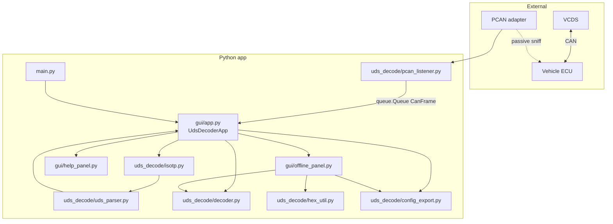
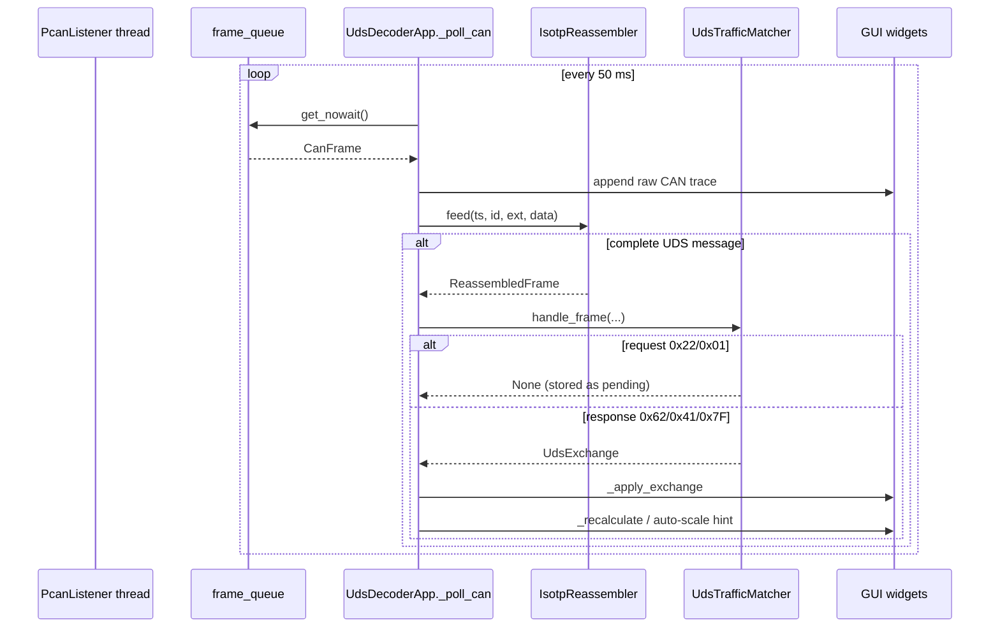
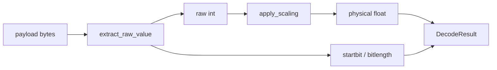
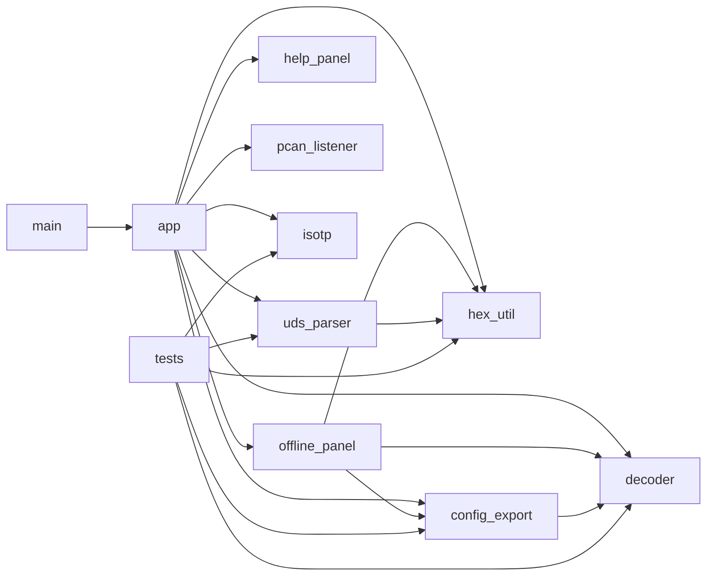
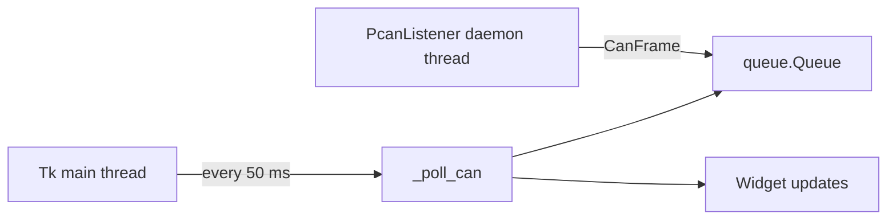

# Software architecture & API reference

> **Audience:** developers who want to understand, modify, or extend this codebase.  
> **Scope:** GitHub documentation only (not shown in the app Help tab).  
> **UDS protocol primer:** see [UNDERSTANDING_UDS.md](UNDERSTANDING_UDS.md) / [understanding-uds.html](understanding-uds.html).  
> **Tip:** open this file on GitHub for rendered Mermaid diagrams, or print/save as PDF from your browser.

---

## Table of contents

1. [System overview](#1-system-overview)
2. [Repository layout](#2-repository-layout)
3. [Runtime data flow](#3-runtime-data-flow)
4. [Module dependency graph](#4-module-dependency-graph)
5. [Core library — `uds_decode/`](#5-core-library--uds_decode)
6. [GUI — `gui/`](#6-gui--gui)
7. [Entry point & tests](#7-entry-point--tests)
8. [Key algorithms](#8-key-algorithms)
9. [Threading & timing](#9-threading--timing)
10. [Extending the code](#10-extending-the-code)
11. [Quick symbol index](#11-quick-symbol-index)

---

## 1. System overview

This application is a **passive UDS reverse-engineering tool**: VCDS talks to the car; PCAN sniffs; the GUI lets you map response bytes to physical values and export `signals.yaml` / `ids.txt`.



| Layer | Responsibility |
|-------|----------------|
| **Hardware I/O** | `pcan_listener` — python-can, `BusState.PASSIVE` |
| **Transport** | `isotp` — ISO 15765-2 reassembly |
| **Application** | `uds_parser` — Mode 22 / Mode 01 pairing |
| **Signal math** | `decoder` — bit extract + linear scale |
| **I/O helpers** | `hex_util` — offline hex / grid construction |
| **Persistence** | `config_export` — YAML + ids.txt |
| **UI** | `gui/*` — Live / Offline / Help tabs |

---

## 2. Repository layout

```
uds-decoder/                      ← git root
├── README.md
├── docs/
│   ├── UNDERSTANDING_UDS.md      ← protocol guide (text)
│   ├── understanding-uds.html    ← protocol guide (app Help + browser)
│   └── SOFTWARE.md               ← this file
└── uds-decoder/                  ← Python package root (run from here)
    ├── main.py
    ├── requirements.txt
    ├── gui/
    │   ├── app.py                ← Live tab + notebook shell
    │   ├── offline_panel.py
    │   ├── help_panel.py
    │   └── __init__.py
    ├── uds_decode/
    │   ├── pcan_listener.py
    │   ├── isotp.py
    │   ├── uds_parser.py
    │   ├── decoder.py
    │   ├── hex_util.py
    │   ├── config_export.py
    │   └── __init__.py
    └── tests/
        └── test_decode.py
```

**Run:** `cd uds-decoder && python main.py`  
**Tests:** `python -m unittest tests.test_decode -v`

---

## 3. Runtime data flow

### Live (PCAN) path



### Offline path


### Decode path (shared)



---

## 4. Module dependency graph



**Design rule:** `uds_decode/*` has **no** tkinter imports. GUI imports the library; never the reverse.

---

## 5. Core library — `uds_decode/`

### 5.1 `pcan_listener.py` — passive CAN capture

| Symbol | Type | Description |
|--------|------|-------------|
| `CanFrame` | dataclass | `timestamp`, `arbitration_id`, `is_extended_id`, `data: bytes` |
| `DEFAULT_CHANNELS_USB` / `_LAN` | const | `PCAN_USBBUS1–8`, `PCAN_LANBUS1–16` |
| `PCAN_INTERFACE_OPTIONS` | dict | UI labels → channel lists |
| `DEFAULT_BITRATES` | list | 125k … 1M |
| `detect_pcan_channels()` | fn | Asks python-can for available PCAN channels |
| `PcanListener` | class | Background reader into a `queue.Queue` |

**`PcanListener` methods**

| Method | Description |
|--------|-------------|
| `__init__(frame_queue, on_error=None)` | Stores queue + optional error callback |
| `connect(channel, bitrate)` | Opens `can.Bus(..., state=BusState.PASSIVE)`, starts daemon thread |
| `disconnect()` | Stops thread, shuts down bus |
| `is_connected` / `frame_count` | Properties |
| `_read_loop()` | `bus.recv(0.1)` → wrap `CanFrame` → `queue.put` |

---

### 5.2 `isotp.py` — ISO-TP reassembly

| Symbol | Description |
|--------|-------------|
| `ReassembledFrame` | Completed UDS payload: `timestamp`, id, ext flag, `data: bytes` |
| `_TpSlot` | Internal per-ID assembly state |
| `IsotpReassembler` | Public API |
| `feed(ts, id, ext, data) → Optional[ReassembledFrame]` | Consume one CAN frame |

**PCI handling inside `feed`:**

| First nibble | Action |
|--------------|--------|
| `0x0` | Single frame → return immediately |
| `0x1` | First frame → start slot, wait for CF |
| `0x2` | Consecutive → append; return when length met |
| `0x3` | Flow control → ignore |

---

### 5.3 `uds_parser.py` — request / response pairing

| Symbol | Description |
|--------|-------------|
| `UdsExchange` | Matched pair: IDs, `reg`, `response_header`, `uds_start_index`, `payload` (24-byte grid), negative flags |
| `derive_request_id(resp_id, ext)` | OBD −8 / VAG −0x6A / extended −0x20000 |
| `decode_negative(data)` | Map NRC byte → human string |
| `parse_request(...)` | Detect `0x22` / `0x01` → `(req_id, reg)` |
| `parse_response(...)` | Detect `0x62` / `0x41` / `0x7F` → `UdsExchange` |
| `UdsTrafficMatcher.handle_frame(...)` | Stateful request→response matcher |

**`UdsExchange` fields (important)**

| Field | Meaning |
|-------|---------|
| `reg` | Request-side REG for ids.txt (`22…` / `01…`) |
| `response_header` | On-bus response header (`62…` / `41…`) |
| `uds_start_index` | Grid index of first UDS byte (`1` if byte 0 is PCI) |
| `payload` | 24-byte display grid (PCI reconstructed for live UDS-only input) |

---

### 5.4 `decoder.py` — extract & scale

| Symbol | Description |
|--------|-------------|
| `ByteOrder` | `MSB` / `LSB` |
| `SignType` | `+` unsigned, `-` signed, `f` float |
| `DecodeParams` | selected bytes, bitmask, mult, offset, sign, byteorder, `uds_start_index` |
| `DecodeResult` | raw, physical, startbit, bitlength, bitmask |
| `auto_bitmask(n)` | Full mask for `n` bytes |
| `bitmask_offset_and_length(mask, n)` | Offset + length inside selected window |
| `extract_raw_value(...)` | Pack selected bytes → raw; compute startbit |
| `apply_scaling(...)` | `physical = raw × mult + offset` (+ signed/float) |
| `decode_signal(payload, params)` | Full pipeline → `DecodeResult` |
| `extract_raw(...)` | Raw only |
| `fit_scale_offset_two_point(...)` | Two-point linear fit → `(mult, offset)` |
| `fit_multiplier_from_reference(raw, phys, offset)` | `mult = (phys − offset) / raw` |
| `decode_physical(raw, mult, offset)` | Simple helper |
| `convert_data_legacy(...)` | Compatibility with original uds-decoder converter |

**Startbit rule:**  
`startbit = (min_selected_index − uds_start_index) × 8 + bitmask_offset`  
Export bit length = `len(selected_bytes) × 8`.

---

### 5.5 `hex_util.py` — hex / grid helpers

| Function | Returns / role |
|----------|----------------|
| `parse_hex_bytes(text)` | `list[int]` from `"04 62 …"` |
| `parse_can_id(text)` | int from `"0x7E8"` / decimal |
| `strip_isotp(data, relaxed=False)` | Drop leading PCI `0x0N` |
| `format_byte_bits(value)` | `"00001110"` |
| `pad_uds_bytes(data, size=24)` | Pad/truncate for GUI |
| `is_isotp_pci(byte)` | True if high nibble is `0` |
| `uds_start_index(data)` | `0` or `1` |
| `single_frame_pci_byte(len)` | Build `0x0N` |
| `response_header_from_uds(uds)` | `62 DID DID` or `41 PID` |
| `request_reg_from_response_header(header)` | `62→22`, `41→01` |
| `grid_bytes_from_can_or_uds(data)` | `(grid, uds_start)` — keep or rebuild PCI |
| `uds_response_message` / `uds_response_payload` | `(header, grid, uds_start)` |
| `uds_request_message(data)` | `(reg, uds_bytes)` |
| `format_hex_bytes(data)` | Display string |

---

### 5.6 `config_export.py` — persistence

| Symbol | Description |
|--------|-------------|
| `SignalDefinition` | Full signal record (IDs, reg, type, conv, unit, …) |
| `.to_yaml_dict()` | `conv: {offset, mult}` |
| `.to_ids_txt_line()` | `[CCAN=UDS,…,CONV={add,mult,1}]` |
| `signal_from_yaml_dict(data)` | Load; merges legacy `div` into effective mult |
| `save_signals` / `load_signals` / `append_signal` | YAML file I/O |

---

## 6. GUI — `gui/`

### 6.1 `app.py` — shell + Live tab

**`main()`** → constructs `UdsDecoderApp` and `mainloop()`.

**`UdsDecoderApp`** owns:

- `PcanListener` + `queue.Queue`
- `IsotpReassembler` + `UdsTrafficMatcher`
- Notebook tabs: Live, Offline, Help
- Payload buffer (`24` bytes) + `uds_start_index`

| Method group | Methods | Role |
|--------------|---------|------|
| Build UI | `_build_ui`, `_build_connection_frame`, `_build_raw_trace_frame`, `_build_exchange_frame`, `_build_byte_frame`, `_build_decode_frame`, `_build_export_frame` | Layout |
| PCAN | `_toggle_connection`, `_detect_channels`, `_on_pcan_iface_changed`, `_on_can_error` | Connect / channels |
| Trace | `_append_raw_trace`, `_update_raw_trace_line`, `_clear_trace`, `_frame_matches_filter` | PCAN View–style log |
| Pipeline | `_poll_can` (50 ms), `_apply_exchange` | Live decode loop |
| Tuning | `_recalculate`, `_apply_auto_scale_from_ref`, `_on_byte_check`, `_on_offset_changed` | Scale UI |
| Export | `_build_signal_definition`, `_save_signal`, `_copy_ids_line`, `_load_signals_dialog` | YAML / ids.txt |

**Constants:** `PAYLOAD_BYTES=24`, `POLL_MS=50`, highlight colors, `RAW_TRACE_MAX_LINES=500`.

**Helper:** `format_raw_can_line(line_num, frame)` — one trace row.

---

### 6.2 `offline_panel.py` — Offline Decode tab

| Method | Role |
|--------|------|
| `_parse_response_payload` | Hex → header, grid, `uds_start_index` |
| `_load_point1` / `_load_point2` | Load grids from two captures |
| `_calculate_two_point` | Fit mult/offset from two expected VCDS values |
| `_recalculate` / `_update_report` | Live report text + ids line |
| `_build_signal_definition` | Export object |

---

### 6.3 `help_panel.py` — Help tab

| Symbol | Role |
|--------|------|
| `docs_dir()` / `help_html_path()` | Locate `docs/understanding-uds.html` |
| `HelpPanel` | Loads HTML via TkinterWeb (`load_html`, CSS 2.1–safe doc) |
| `_open_in_browser` | Opens the same HTML in the system browser |

---

## 7. Entry point & tests

### `main.py`

```python
from gui.app import main
if __name__ == "__main__":
    main()
```

### `tests/test_decode.py`

| Class | Covers |
|-------|--------|
| `TestIsotpReassembler` | SF / FF+CF / extended ID |
| `TestDecoder` | bitmask, scale, signed, two-point, reference mult, 1:1 packing |
| `TestUdsParser` | ID derivation, Mode 22/01, matcher, NRC |
| `TestHexUtil` | hex parse, response payload + PCI |
| `TestConfigExport` | ids.txt line format |

---

## 8. Key algorithms

### 8.1 Raw packing (MSB)

Selected bytes `[b0, b1, …]` →  
`raw = b0<<(8*(n-1)) | b1<<(8*(n-2)) | …`  
No post-shift masking of the packed value (matches original Form1 “mirror bytes” behavior). Bitmask only affects startbit offset / signed length.

### 8.2 Two-point fit

Given `(raw1, phys1)`, `(raw2, phys2)`:

```
mult   = (phys2 − phys1) / (raw2 − raw1)
offset = phys1 − raw1 × mult
```

### 8.3 Suggested multiplier (Live)

With fixed UI offset:

```
mult_suggested = (vcds_ref − offset) / raw
```

Displayed only — does **not** write the Multiplier entry.

### 8.4 Grid + PCI

- Pasted CAN frame starting with `0x0N` → keep PCI at index 0.  
- Live reassembled UDS (no PCI) length ≤ 7 → prepend reconstructed PCI.  
- `uds_start_index` tracks where UDS begins for startbit math.

---

## 9. Threading & timing



- **Only** the listener thread touches the CAN bus.  
- **Only** the Tk thread updates widgets.  
- Cross-thread handoff is the queue (thread-safe).  
- Errors from the reader call `on_error` → scheduled onto the UI via `after(0, …)`.

---

## 10. Extending the code

| Goal | Where to change |
|------|-----------------|
| New UDS service (e.g. 0x2C) | `uds_parser.parse_request` / `parse_response` + matcher service sets |
| New scale model | `decoder.apply_scaling` + GUI fields |
| New export format | `config_export.SignalDefinition` |
| New PCAN interface type | `PCAN_INTERFACE_OPTIONS` in `pcan_listener` |
| More Help content | `docs/understanding-uds.html` (CSS 2.1) |
| Protocol docs | `docs/UNDERSTANDING_UDS.md` |

**Testing:** add cases under `tests/test_decode.py` and run unittest.

---

## 11. Quick symbol index

| Symbol | Module |
|--------|--------|
| `CanFrame`, `PcanListener`, `detect_pcan_channels` | `pcan_listener` |
| `IsotpReassembler`, `ReassembledFrame` | `isotp` |
| `UdsExchange`, `UdsTrafficMatcher`, `derive_request_id` | `uds_parser` |
| `DecodeParams`, `decode_signal`, `fit_scale_offset_two_point` | `decoder` |
| `grid_bytes_from_can_or_uds`, `request_reg_from_response_header` | `hex_util` |
| `SignalDefinition`, `append_signal` | `config_export` |
| `UdsDecoderApp`, `main` | `gui.app` |
| `OfflineDecodePanel` | `gui.offline_panel` |
| `HelpPanel` | `gui.help_panel` |

---

## Related docs

| Doc | Purpose |
|-----|---------|
| [README.md](../README.md) | Quick start, wiring, user workflow |
| [UNDERSTANDING_UDS.md](UNDERSTANDING_UDS.md) | Protocol primer (DID/PID, layers) |
| [understanding-uds.html](understanding-uds.html) | Same primer, illustrated (app Help) |

*Generated for maintainers of [uds-decoder](https://github.com/RaheelFarouk/uds-decoder). Prefer editing this markdown over a PDF so diagrams and APIs stay in sync with the code.*
